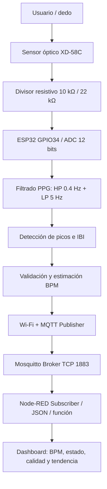

# PULSO-IoT

**Sistema académico de adquisición, procesamiento y monitorización de pulso cardíaco mediante PPG e IoT.**

Proyecto desarrollado en el contexto de Sensórica para Ingenierías, Ingeniería Electrónica, Universidad Surcolombiana. La implementación final documentada utiliza un sensor óptico XD-58C, una tarjeta ESP32 DevKit V1, firmware programado desde Arduino IDE y comunicación Wi-Fi/MQTT hacia un broker Mosquitto y una interfaz Node-RED.

> **Alcance real:** el prototipo adquiere una señal fotopletismográfica (PPG) y estima frecuencia cardíaca en BPM. La propuesta inicial contemplaba frecuencia cardíaca y SpO₂ con otro sensor, pero la implementación documentada no calcula SpO₂. No es un dispositivo médico ni está validado clínicamente.

## Arquitectura



## Hardware

| Elemento | Función |
|---|---|
| XD-58C | Captura variaciones ópticas asociadas al pulso periférico y produce señal PPG. |
| ESP32 DevKit V1 | Adquiere, procesa y transmite la información. |
| R1 = 10 kΩ | Resistencia serie entre salida del sensor y nodo de lectura. |
| R2 = 22 kΩ | Resistencia desde el nodo de lectura a GND; forma el divisor. |
| GPIO34 | Entrada ADC de la señal acondicionada. |
| GPIO27 | Pulsador de presencia del dedo, INPUT_PULLUP, activo en LOW. |
| GPIO26 | Interruptor de sesión, INPUT_PULLUP, activo en LOW. |

Con el divisor descrito, la relación ideal es `V_GPIO34 = V_sensor × 22/(10+22) ≈ 0.6875 × V_sensor`. Sensor y ESP32 deben compartir GND. Verifica siempre el rango eléctrico admisible de la entrada antes de conectar el circuito.

## Firmware y procesamiento

- Muestreo: 100 Hz; período de muestreo: 10 ms.
- ADC: 12 bits, rango digital 0–4095; atenuación configurada como `ADC_11db`.
- Filtrado IIR: pasa-altas de 0.4 Hz y pasa-bajas de 5 Hz.
- Detección por cruce de umbral, con umbral mínimo de 60 mV y ajuste adaptativo basado en la envolvente positiva.
- Validación del IBI entre 300 y 2000 ms y ancho de pulso entre 40 y 600 ms.
- Se utiliza historial de hasta cinco intervalos y coeficiente de variación máximo del 20 %.
- `BPM` solo se presenta como válido cuando `QUALITY = 2`.

### Variables del Monitor Serie

| Variable | Significado |
|---|---|
| `PPG` | Señal PPG después del filtrado digital, en mV. Puede ser positiva o negativa porque el filtro elimina la componente continua. |
| `TH` | Umbral adaptativo de detección, en mV; mínimo configurado de 60 mV. |
| `BPM` | Frecuencia cardíaca estimada a partir del intervalo entre pulsos: `BPM = 60000 / IBI_ms`. Se muestra en cero si no está validada. |
| `QUALITY` | Código categórico: 0 sin medición, 1 búsqueda, 2 validada, 3 inestable. No es un porcentaje. |

## Comunicaciones IoT

- Transporte local: Wi-Fi y TCP.
- Protocolo de mensajería: MQTT 3.x mediante PubSubClient.
- Broker: Eclipse Mosquitto, puerto TCP 1883 (sin TLS en la configuración de laboratorio documentada).
- Topic de telemetría: `pulso-iot/device01/telemetry`.
- Usuario publicador: `pulso_esp32`.
- Usuario suscriptor: `pulso_dashboard`.
- Intervalo de publicación configurado: 5 segundos. La adquisición PPG continúa a 100 Hz; no debe confundirse la frecuencia de muestreo con el intervalo de telemetría.
- Node-RED recibe el mensaje, lo convierte desde JSON y distribuye BPM, estado, calidad y tendencia a la interfaz.

La IP del broker debe ser la dirección IPv4 actual del computador que ejecuta Mosquitto. Puede cambiar al pasar de la red doméstica al hotspot del celular. No se deben fijar IPs personales ni contraseñas en los archivos públicos.

## Puesta en marcha

1. Revisa `hardware/conexiones.md`.
2. Configura el firmware siguiendo `firmware/README.md`.
3. Configura Mosquitto a partir de `mosquitto/mosquitto.example.conf` y `mosquitto/acl.example.txt`. Crea el archivo de contraseñas localmente; no lo publiques.
4. Autoriza únicamente el tráfico TCP 1883 necesario en el firewall del computador.
5. Importa/configura el flujo Node-RED que utiliza el topic indicado. Las instrucciones para exportar el flujo real están en `node-red/README.md`; el archivo de flujo original aún debe añadirse desde la instalación del equipo.
6. Comprueba la recepción MQTT en Mosquitto/Node-RED y luego abre el dashboard.

## Estructura

```text
PULSO-IoT/
├── README.md
├── LICENSE-STATUS.md
├── .gitignore
├── firmware/
├── hardware/
│   ├── conexiones.md
│   └── evidencias/
├── mosquitto/
├── node-red/
├── docs/
└── documentacion/
    ├── informes/
    ├── presentacion/
    └── propuesta_inicial/
```

## Evidencias y documentación

- `documentacion/informes/`: informe final Word y PDF.
- `documentacion/presentacion/`: presentación CDIO en PPTX y PDF.
- `documentacion/propuesta_inicial/`: presentación inicial Cuida Tu Salud, con matrices de selección.
- `hardware/evidencias/`: capturas originales del montaje, osciloscopio, monitor serie, Serial Plotter, Arduino IDE, Mosquitto y dashboard.

## Limitaciones conocidas

1. La salida PPG depende de la ubicación y presión del dedo, el movimiento y la luz ambiente.
2. La clasificación `VALID` solo significa que se cumplieron las reglas programadas; no equivale a validación clínica.
3. No se implementó SpO₂ en la versión final documentada.
4. La publicación MQTT se configuró cada 5 s, aunque el muestreo interno es de 100 Hz.
5. El dashboard y las capturas reflejan pruebas de laboratorio; no se ha documentado una campaña formal de exactitud frente a un instrumento patrón.

## Autores del proyecto

Equipo indicado en la propuesta inicial: Santiago Delgado Gómez, Stefany Díaz Chavarro y Juan Manuel Mosquera. Confirmar con el equipo antes de hacer público el repositorio.

## Estado del repositorio

Este paquete es una base preparada para GitHub. Para que el repositorio quede totalmente reproducible falta incorporar el **flujo Node-RED exportado desde la instalación real**, confirmar la autoría/visibilidad y verificar la configuración local de Mosquitto sin credenciales.
